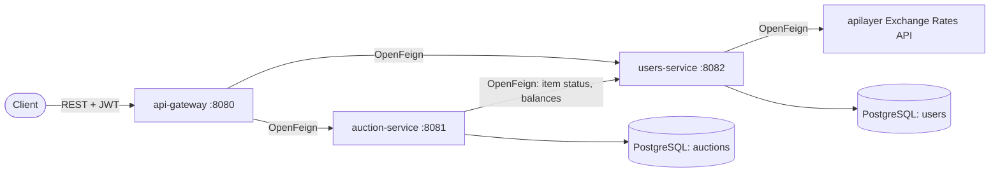

# auction_project

Online auction platform built as three Spring Boot microservices behind a JWT-secured API gateway.

An ADMIN creates accounts, and users log in at `POST /api/v1/auth` to get a JWT. The intended flow: sellers put items up for auction, buyers place bids, and scheduled jobs start auctions, finish them, mark the item as sold and settle the balances. Most of that flow does not work yet; see [Known limitations](#known-limitations).

## Architecture



| Service | Port | Responsibility |
|---|---|---|
| `api-gateway` | 8080 | Public REST API under `/api/v1`. Issues and validates JWTs, hashes passwords with BCrypt, keeps sessions stateless and enforces ADMIN / USER roles. Forwards calls to the other services through OpenFeign clients. |
| `auction-service` | 8081 | Auctions, bids, buyers and sellers. A scheduled job starts `PLANNED` auctions once their start date has passed. The finish job tries to finish `IN_PROGRESS` auctions six hours after their start date and mark the item `SOLD`, but the failing item call rolls the finish back. A third job requests balance settlement, which currently changes no balances (see [Known limitations](#known-limitations)). |
| `users-service` | 8082 | Users and balances, payments, items and categories, and currencies with conversion through the apilayer Exchange Rates Data API. |

Each data service owns its own PostgreSQL database. Their schemas are versioned with Flyway, and database triggers keep current prices, buyers and sellers in sync with new bids and auctions.

`auction-service` and `users-service` have no authentication of their own and expose all actuator endpoints. They rely on running in an isolated network, reachable only through the gateway.

## Tech stack

- Java 17, Spring Boot 2.7, Spring Security, Spring Data JDBC, Spring Cloud OpenFeign
- PostgreSQL 13, Flyway
- JWT (jjwt), BCrypt
- MapStruct, Lombok, springdoc-openapi (Swagger UI)
- JUnit 5, Mockito, Spring Boot Test
- Checkstyle, PMD and SpotBugs, which fail the Maven build on violations
- Spotless with palantir-java-format, which fails the build on unformatted Java
- Docker Compose for the databases, plus a GitHub Actions workflow that checks formatting and runs `./mvnw clean verify` on Temurin 17

## Running locally

Requirements: JDK 17, Docker, and `curl` or `wget` plus `unzip` for the Maven Wrapper (`./mvnw` downloads Maven 3.9.16). The migration script in step 2 still calls Maven directly, so it also needs Maven 3.8+.

1. Start the databases. users-service gets port 15432 and auction-service gets port 15433.

   ```bash
   docker compose up -d
   ```

2. Apply the Flyway migrations for each data service:

   ```bash
   (cd users-service && sh ../script/migration.sh)
   (cd auction-service && sh ../script/migration.sh)
   ```

   The users-service migrations seed an ADMIN account (`test@admin.com`) and a USER account (`test@user.com`) for local development.

3. Provide the secrets as environment variables. They are never committed.

   | Variable | Used by | Purpose |
   |---|---|---|
   | `JWT_SECRET` | api-gateway | HMAC key that signs and validates JWTs |
   | `EXCHANGE_API_KEY` | users-service | API key for the [apilayer Exchange Rates Data API](https://apilayer.com/marketplace/exchangerates_data-api). Only the currency convert and symbols endpoints call it, so any non-empty value lets the service start. |

4. Build the project, then run `UsersApplication`, `AuctionApplication` and `ApiGatewayApplication`, for example from your IDE:

   ```bash
   ./mvnw clean install -DskipTests
   ```

Each service serves Swagger UI at `/swagger-ui/index.html`. On the gateway, that path requires an ADMIN JWT.

## Development

- Format before every commit: `./mvnw spotless:apply`. Unformatted Java fails `./mvnw verify` at `validate`, locally and in CI.
- Optional pre-commit hook, once per clone: `git config core.hooksPath .githooks`. It formats your staged Java files and stops the commit if it changed any of them, so you can review and `git add` the result.
- `git config blame.ignoreRevsFile .git-blame-ignore-revs` makes local `git blame` skip the one-time reformat. GitHub does this automatically.

## Known limitations

The fixes are planned as OpenSpec changes in [`openspec/changes/`](openspec/changes/).

- Creating an auction through the gateway fails. auction-service's `POST /api/v1/sellers` returns no body, so the gateway reads a null seller and answers "Auction creation fails, please try again later". Fixed in [`auction-lifecycle-fixes`](openspec/changes/auction-lifecycle-fixes/proposal.md).
- The gateway can't set an auction's start date, so auctions created through it never start. Only auction-service itself has `PATCH /api/v1/auctions/{id}/date`. Fixed in [`auction-lifecycle-fixes`](openspec/changes/auction-lifecycle-fixes/proposal.md).
- Joining and bidding through the gateway fail. Joining throws before the first bid, because the self-join check reads the auction's leading buyer, which is still empty. A successful bid still answers "balance is not enough", because the gateway's bid path has no `return` after placing it. Fixed in [`auction-lifecycle-fixes`](openspec/changes/auction-lifecycle-fixes/proposal.md).
- Finishing an auction rolls back. Inside its database transaction, the finish job asks users-service to mark the item `SOLD`. That request carries no price, users-service writes `NULL` into the `NOT NULL` `items.price` column and fails, and the whole finish is rolled back. Fixed in [`outbox-publisher`](openspec/changes/outbox-publisher/proposal.md), which takes the call out of the transaction, and [`settlement-consumer`](openspec/changes/settlement-consumer/proposal.md), which marks the item sold.
- Balance settlement does nothing. auction-service sends the user type as `BUYER` / `SELLER`, users-service expects `buyer` / `seller`, so it logs a warning and leaves the balance unchanged, and the auction is marked as paid anyway. The balance update also runs in a read-only transaction. Fixed in [`settlement-consumer`](openspec/changes/settlement-consumer/proposal.md), which moves settlement to Kafka events.
- `AuctionItemsTest` is disabled: it can't resolve its constructor parameters, and it needs a manually migrated database. [`testcontainers-postgres`](openspec/changes/testcontainers-postgres/proposal.md) replaces it with a self-contained integration test.

## Roadmap

- Upgrade to Java 21 and Spring Boot 4.2, through Spring Boot 3.5
- Replace the balance-settlement Feign call with Kafka events
- Integration tests with Testcontainers
- Dockerfiles and a single-command `docker compose` setup for the whole system
